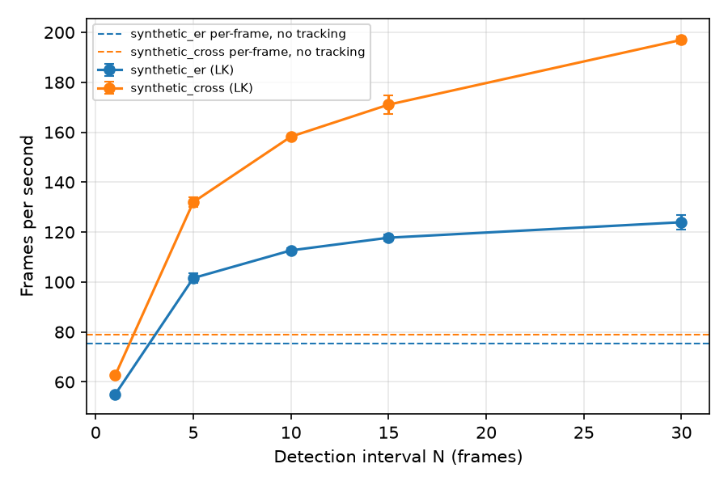
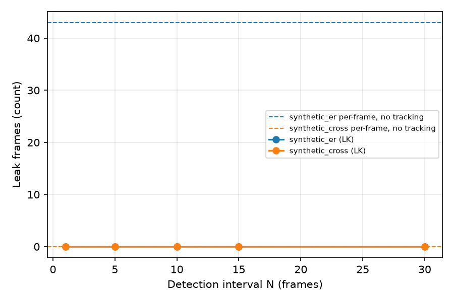

# FaceGuard — Results

Everything between the GENERATED markers is rewritten by
`python eval/run_experiments.py --config eval/experiments.yaml`. The
milestone notes after it were recorded by hand while building and are kept
as they are.

<!-- BEGIN GENERATED: eval/run_experiments.py -->

_Generated 2026-11-16 by `python eval/run_experiments.py --config eval/experiments.yaml`. Do not edit by hand; edit the script or the config and re-run._

## Environment

|  |  |
|---|---|
| CPU | Apple M5, 10 cores |
| OS | Darwin 27.2.0 |
| Python | 3.13.14 |
| OpenCV | 5.0.0 |
| Model | `face_detection_yunet_2026may.onnx` (SHA-256 `ebafce4e…22f0f0`) |
| ffmpeg | ffmpeg version 9.0.2 Copyright (c) 2000-2026 the FFmpeg developers |
| Peak RSS | 658 MB |
| Timing runs | 3 per configuration, mean ± sample std |

FPS is the processing loop (decode + detect/track + redact + write), excluding the final ffmpeg re-encode.

## Datasets

| Clip | Ground truth | Frames | Face-frames | Segments |
|---|---|---|---|---|
| synthetic_er | synthetic, exact boxes | 600 | 3600 | static, slow_pan, rotation, fast_pan, low_light, small_faces |
| synthetic_cross | synthetic, exact boxes | 450 | 1039 | approach, crossing, separate, entry, static |

Images: **7** hand-annotated, **40** stills sampled from the synthetic clip (316 faces in total).

> **About the real photos:** seven public OpenCV / MIT-CMU test photographs, labelled by an AI assistant from detector proposals with visual verification (see the provenance note in `data/ground_truth.json`). Box geometry follows YuNet, which favours YuNet at the IoU 0.5 match, and the photos are easy. **No real video is annotated**: all video results are on synthetic clips. Treat these as indicative, not as field accuracy.

## Headline

- **synthetic_er:** detecting every 10 frames with Lucas-Kanade tracking ran at **1.50x** the throughput of per-frame detection (112.7 vs 75.2 FPS) while changing leak frames from **43** to **0**.
- **synthetic_cross:** detecting every 10 frames with Lucas-Kanade tracking ran at **2.00x** the throughput of per-frame detection (158.2 vs 78.9 FPS) while changing leak frames from **0** to **0**.

## E1 — YuNet vs Haar on images

| Set | Detector | Images | Faces | TP | FP | FN | Precision | Recall | F1 | Mean coverage | ms / image |
|---|---|---|---|---|---|---|---|---|---|---|---|
| real photos | yunet | 7 | 76 | 76 | 0 | 0 | 1.000 | 1.000 | 1.000 | 1.000 | 6.490 |
| real photos | haar | 7 | 76 | 72 | 4 | 4 | 0.947 | 0.947 | 0.947 | 0.961 | 23.4 |
| synthetic stills | yunet | 40 | 240 | 234 | 0 | 6 | 1.000 | 0.975 | 0.987 | 0.975 | 10.1 |
| synthetic stills | haar | 40 | 240 | 199 | 68 | 41 | 0.745 | 0.829 | 0.785 | 0.829 | 25.4 |

Per-frame detection on the clips (no tracking):

| Clip | Detector | FPS | Precision | Recall | Leak frames | Track IDs |
|---|---|---|---|---|---|---|
| synthetic_er | yunet | 75.2 | 1.000 | 0.969 | 43 | 174 |
| synthetic_er | haar | 34.2 | 0.757 | 0.825 | 230 | 313 |
| synthetic_cross | yunet | 78.9 | 0.993 | 0.999 | 0 | 4 |
| synthetic_cross | haar | 37.8 | 0.792 | 0.925 | 24 | 148 |

## E2 — detection interval sweep (LK tracking)

**synthetic_er**

| Detection | Detector calls | FPS | Leak frames | Mean coverage | Track IDs |
|---|---|---|---|---|---|
| per-frame, no tracking | 600 | 75.2 ± 0.7 | 43 | 0.970 | 174 |
| every 1 | 600 | 55.0 ± 0.7 | 0 | 1.000 | 6 |
| every 5 | 132 | 101.6 ± 1.9 | 0 | 1.000 | 6 |
| every 10 | 72 | 112.7 ± 0.7 | 0 | 1.000 | 6 |
| every 15 | 51 | 117.8 ± 1.4 | 0 | 1.000 | 6 |
| every 30 | 32 | 124.0 ± 2.9 | 0 | 0.999 | 6 |

**synthetic_cross**

| Detection | Detector calls | FPS | Leak frames | Mean coverage | Track IDs |
|---|---|---|---|---|---|
| per-frame, no tracking | 450 | 78.9 ± 1.4 | 0 | 1.000 | 4 |
| every 1 | 450 | 62.6 ± 0.2 | 0 | 1.000 | 4 |
| every 5 | 105 | 132.0 ± 2.0 | 0 | 1.000 | 4 |
| every 10 | 61 | 158.2 ± 0.3 | 0 | 1.000 | 4 |
| every 15 | 43 | 171.0 ± 3.6 | 0 | 1.000 | 4 |
| every 30 | 25 | 197.0 ± 1.5 | 0 | 1.000 | 4 |

## E3 — tracker comparison (detect every 10 frames)

**synthetic_er**

| Tracker | FPS | Leak frames | Mean coverage | ID consistency | ID switches | Track IDs | Mean frames / track |
|---|---|---|---|---|---|---|---|
| lk | 112.7 ± 0.7 | 0 | 1.000 | 1.000 | 0 | 6 | 600 |
| csrt | 20.4 ± 0.1 | 0 | 1.000 | 1.000 | 3 | 7 | 518 |
| kcf | 50.7 ± 0.9 | 0 | 0.999 | 0.998 | 172 | 116 | 53.8 |
| none | 160.6 ± 1.7 | 56 | 0.972 | 0.986 | 271 | 199 | 42.1 |
| off | 75.2 ± 0.7 | 43 | 0.970 | 1.000 | 168 | 174 | 20.1 |

**synthetic_cross**

| Tracker | FPS | Leak frames | Mean coverage | ID consistency | ID switches | Track IDs | Mean frames / track |
|---|---|---|---|---|---|---|---|
| lk | 158.2 ± 0.3 | 0 | 1.000 | 1.000 | 1 | 4 | 277.5 |
| csrt | 44.7 ± 0.1 | 0 | 1.000 | 1.000 | 1 | 4 | 278 |
| kcf | 111.4 ± 1.6 | 0 | 1.000 | 1.000 | 1 | 4 | 267 |
| none | 274.6 ± 4.4 | 39 | 0.988 | 1.000 | 4 | 7 | 158.4 |
| off | 78.9 ± 1.4 | 0 | 1.000 | 1.000 | 1 | 4 | 261.2 |

`off` = detect every frame with no memory; `none` = hold each box still between detections. ID switches count every time a ground-truth person's matched track ID changes, including re-acquisition after full occlusion.

## E4 — YuNet confidence threshold

**Real photos** (average precision 1.000)

| Threshold | Precision | Recall | F1 | FP | FN |
|---|---|---|---|---|---|
| 0.300 | 0.974 | 1.000 | 0.987 | 2 | 0 |
| 0.500 | 0.987 | 1.000 | 0.994 | 1 | 0 |
| 0.600 | 1.000 | 1.000 | 1.000 | 0 | 0 |
| 0.700 | 1.000 | 1.000 | 1.000 | 0 | 0 |
| 0.900 | 1.000 | 0.803 | 0.890 | 0 | 15 |

**Synthetic stills** (average precision 0.992)

| Threshold | Precision | Recall | F1 | FP | FN |
|---|---|---|---|---|---|
| 0.300 | 1.000 | 0.983 | 0.992 | 0 | 4 |
| 0.500 | 1.000 | 0.979 | 0.990 | 0 | 5 |
| 0.600 | 1.000 | 0.975 | 0.987 | 0 | 6 |
| 0.700 | 1.000 | 0.963 | 0.981 | 0 | 9 |
| 0.900 | 1.000 | 0.758 | 0.863 | 0 | 58 |

## E5 — condition breakdown, real photos

| Group | Faces | yunet recall | yunet coverage | haar recall | haar coverage |
|---|---|---|---|---|---|
| crowd | 57 | 1.000 | 1.000 | 0.947 | 0.948 |
| defocused_crowd | 1 | 1.000 | 1.000 | 1.000 | 1.000 |
| group | 14 | 1.000 | 1.000 | 1.000 | 1.000 |
| halftone_print | 2 | 1.000 | 1.000 | 0.500 | 1.000 |
| low_light | 7 | 1.000 | 1.000 | 1.000 | 1.000 |
| motion | 1 | 1.000 | 1.000 | 1.000 | 1.000 |
| normal_light | 9 | 1.000 | 1.000 | 1.000 | 1.000 |
| portrait | 2 | 1.000 | 1.000 | 1.000 | 1.000 |
| small_faces | 57 | 1.000 | 1.000 | 0.947 | 0.948 |
| medium (size) | 17 | 1.000 | 1.000 | 0.941 | 1.000 |
| small (size) | 59 | 1.000 | 1.000 | 0.949 | 0.949 |

## E5 — condition breakdown, synthetic stills

Images, recall at IoU 0.5 and mean mask coverage at the default padding. Size groups by box width: small < 40 px, large > 100 px.

| Group | Faces | yunet recall | yunet coverage | haar recall | haar coverage |
|---|---|---|---|---|---|
| fast_pan | 24 | 1.000 | 1.000 | 0.917 | 0.917 |
| low_light | 36 | 1.000 | 1.000 | 0.972 | 0.972 |
| other | 12 | 1.000 | 1.000 | 1.000 | 1.000 |
| rotation | 48 | 0.875 | 0.874 | 0.500 | 0.500 |
| slow_pan | 48 | 1.000 | 1.000 | 0.938 | 0.938 |
| small_faces | 24 | 1.000 | 1.000 | 0.583 | 0.583 |
| static | 48 | 1.000 | 1.000 | 0.979 | 0.979 |
| medium (size) | 224 | 0.973 | 0.973 | 0.857 | 0.857 |
| small (size) | 16 | 1.000 | 1.000 | 0.438 | 0.437 |
| synthetic (source) | 240 | 0.975 | 0.975 | 0.829 | 0.829 |

Video leak frames by segment:

**synthetic_er**

| Tracker | static | slow_pan | rotation | fast_pan | low_light | small_faces |
|---|---|---|---|---|---|---|
| lk | 0 | 0 | 0 | 0 | 0 | 0 |
| csrt | 0 | 0 | 0 | 0 | 0 | 0 |
| kcf | 0 | 0 | 0 | 0 | 0 | 0 |
| none | 0 | 11 | 35 | 10 | 0 | 0 |
| off | 0 | 0 | 43 | 0 | 0 | 0 |

**synthetic_cross**

| Tracker | approach | crossing | separate | entry | static |
|---|---|---|---|---|---|
| lk | 0 | 0 | 0 | 0 | 0 |
| csrt | 0 | 0 | 0 | 0 | 0 |
| kcf | 0 | 0 | 0 | 0 | 0 |
| none | 21 | 2 | 4 | 8 | 4 |
| off | 0 | 0 | 0 | 0 | 0 |

## E6 — padding sweep (LK, detect every 10)

Mask area ratio = masked pixels / detector box area (what padding costs).

**synthetic_er**

| Padding | Mean coverage | Leak frames | Mask area ratio |
|---|---|---|---|
| 0.000 | 0.834 | 600 | 0.891 |
| 0.100 | 0.966 | 32 | 1.263 |
| 0.200 | 0.999 | 0 | 1.703 |
| 0.250 | 1.000 | 0 | 1.931 |
| 0.300 | 1.000 | 0 | 2.190 |

**synthetic_cross**

| Padding | Mean coverage | Leak frames | Mask area ratio |
|---|---|---|---|
| 0.000 | 0.837 | 427 | 0.863 |
| 0.100 | 0.969 | 2 | 1.230 |
| 0.200 | 0.999 | 0 | 1.662 |
| 0.250 | 1.000 | 0 | 1.889 |
| 0.300 | 1.000 | 0 | 2.141 |

## E7 — early-detection policy (LK, detect every 10)

Each row adds one rule for running the detector off schedule (DECISIONS D-017). The default is the last row with the configured interval (`unconfirmed_interval` = 3).

**synthetic_er**

| Policy | FPS | Detector calls | Early | Leak frames | static | slow_pan | rotation | fast_pan | low_light | small_faces |
|---|---|---|---|---|---|---|---|---|---|---|
| scheduled only | 122.5 ± 2.2 | 60 | 0 | 0 | 0 | 0 | 0 | 0 | 0 | 0 |
| + lost track | 124.1 ± 0.9 | 60 | 0 | 0 | 0 | 0 | 0 | 0 | 0 | 0 |
| + unconfirmed, every 1 | 114.2 ± 3.2 | 94 | 34 | 0 | 0 | 0 | 0 | 0 | 0 | 0 |
| + unconfirmed, every 3 | 112.7 ± 0.7 | 72 | 12 | 0 | 0 | 0 | 0 | 0 | 0 | 0 |

**synthetic_cross**

| Policy | FPS | Detector calls | Early | Leak frames | approach | crossing | separate | entry | static |
|---|---|---|---|---|---|---|---|---|---|
| scheduled only | 179.6 ± 6.5 | 45 | 0 | 0 | 0 | 0 | 0 | 0 | 0 |
| + lost track | 181.3 ± 3.3 | 45 | 0 | 0 | 0 | 0 | 0 | 0 | 0 |
| + unconfirmed, every 1 | 150.7 ± 1.0 | 91 | 46 | 0 | 0 | 0 | 0 | 0 | 0 |
| + unconfirmed, every 3 | 158.2 ± 0.3 | 61 | 16 | 0 | 0 | 0 | 0 | 0 | 0 |

## E8 — mask shape (LK, detect every 10)

Ellipse vs rectangle at each padding (DECISIONS D-020). The rectangle has no corner condition, so it reaches full coverage at lower padding, at the cost of hiding more area.

**synthetic_er**

| Shape | Padding | Mean coverage | Leak frames | Mask area ratio |
|---|---|---|---|---|
| ellipse | 0.000 | 0.834 | 600 | 0.891 |
| ellipse | 0.100 | 0.966 | 32 | 1.263 |
| ellipse | 0.200 | 0.999 | 0 | 1.703 |
| ellipse | 0.250 | 1.000 | 0 | 1.931 |
| rect | 0.000 | 0.993 | 29 | 1.170 |
| rect | 0.100 | 1.000 | 0 | 1.696 |
| rect | 0.200 | 1.000 | 0 | 2.247 |
| rect | 0.250 | 1.000 | 0 | 2.561 |

**synthetic_cross**

| Shape | Padding | Mean coverage | Leak frames | Mask area ratio |
|---|---|---|---|---|
| ellipse | 0.000 | 0.837 | 427 | 0.863 |
| ellipse | 0.100 | 0.969 | 2 | 1.230 |
| ellipse | 0.200 | 0.999 | 0 | 1.662 |
| ellipse | 0.250 | 1.000 | 0 | 1.889 |
| rect | 0.000 | 0.987 | 2 | 1.148 |
| rect | 0.100 | 1.000 | 0 | 1.652 |
| rect | 0.200 | 1.000 | 0 | 2.194 |
| rect | 0.250 | 1.000 | 0 | 2.492 |

## E9 — temporal smoothing (LK, detect every 10)

Jitter = mean magnitude of the second difference of box centres (px). Smoothing is zero-phase and off by default (D-019).

**synthetic_er**

| Window | Jitter (px) | Leak frames | Mean coverage | static | slow_pan | rotation | fast_pan | low_light | small_faces |
|---|---|---|---|---|---|---|---|---|---|
| 1 | 1.021 | 0 | 1.000 | 0 | 0 | 0 | 0 | 0 | 0 |
| 3 | 0.948 | 0 | 1.000 | 0 | 0 | 0 | 0 | 0 | 0 |
| 5 | 0.972 | 5 | 0.999 | 0 | 0 | 0 | 5 | 0 | 0 |
| 9 | 0.911 | 29 | 0.985 | 0 | 0 | 0 | 29 | 0 | 0 |

**synthetic_cross**

| Window | Jitter (px) | Leak frames | Mean coverage | approach | crossing | separate | entry | static |
|---|---|---|---|---|---|---|---|---|
| 1 | 1.007 | 0 | 1.000 | 0 | 0 | 0 | 0 | 0 |
| 3 | 0.830 | 0 | 1.000 | 0 | 0 | 0 | 0 | 0 |
| 5 | 0.848 | 0 | 1.000 | 0 | 0 | 0 | 0 | 0 |
| 9 | 0.781 | 0 | 1.000 | 0 | 0 | 0 | 0 | 0 |

## E10 — coasting lost tracks (detect every 10)

Freeze = a lost box stays where it was; coast = it keeps its last velocity and its mask grows (D-023).

**synthetic_er**

| Tracker | When lost | FPS | Leak frames | Precision | static | slow_pan | rotation | fast_pan | low_light | small_faces |
|---|---|---|---|---|---|---|---|---|---|---|
| lk | freeze | 112.7 ± 0.7 | 0 | 1.000 | 0 | 0 | 0 | 0 | 0 | 0 |
| lk | coast | 119.0 ± 1.2 | 0 | 1.000 | 0 | 0 | 0 | 0 | 0 | 0 |
| csrt | freeze | 20.4 ± 0.1 | 0 | 0.993 | 0 | 0 | 0 | 0 | 0 | 0 |
| csrt | coast | 20.4 ± 0.2 | 0 | 0.993 | 0 | 0 | 0 | 0 | 0 | 0 |
| kcf | freeze | 50.7 ± 0.9 | 0 | 0.573 | 0 | 0 | 0 | 0 | 0 | 0 |
| kcf | coast | 52.5 ± 1.6 | 11 | 0.588 | 0 | 0 | 11 | 0 | 0 | 0 |

**synthetic_cross**

| Tracker | When lost | FPS | Leak frames | Precision | approach | crossing | separate | entry | static |
|---|---|---|---|---|---|---|---|---|---|
| lk | freeze | 158.2 ± 0.3 | 0 | 0.935 | 0 | 0 | 0 | 0 | 0 |
| lk | coast | 170.5 ± 2.0 | 0 | 0.935 | 0 | 0 | 0 | 0 | 0 |
| csrt | freeze | 44.7 ± 0.1 | 0 | 0.933 | 0 | 0 | 0 | 0 | 0 |
| csrt | coast | 45.9 ± 0.2 | 0 | 0.933 | 0 | 0 | 0 | 0 | 0 |
| kcf | freeze | 111.4 ± 1.6 | 0 | 0.972 | 0 | 0 | 0 | 0 | 0 |
| kcf | coast | 116.5 ± 1.7 | 0 | 0.972 | 0 | 0 | 0 | 0 | 0 |

## E11 — tiled detection for small faces (real photos)

YuNet on the full frame alone vs also on n x n upscaled tiles (D-022).

| Tiles | TP | FP | FN | Precision | Recall | ms / image |
|---|---|---|---|---|---|---|
| off | 76 | 0 | 0 | 1.000 | 1.000 | 6.270 |
| 2 x 2 | 76 | 1 | 0 | 0.987 | 1.000 | 35.6 |
| 3 x 3 | 76 | 1 | 0 | 0.987 | 1.000 | 41.9 |

## E12 — backward backfill of new faces (LK, detect every 10)

When a face is first detected it is tracked backwards over the last N buffered frames, so the frames before its first detection are masked too (D-026).

**synthetic_er**

| Backfill N | FPS | Frames filled | Leak frames | Precision | static | slow_pan | rotation | fast_pan | low_light | small_faces |
|---|---|---|---|---|---|---|---|---|---|---|
| 0 | 122.6 ± 1.0 | 0 | 0 | 1.000 | 0 | 0 | 0 | 0 | 0 | 0 |
| 5 | 121.6 ± 1.7 | 0 | 0 | 1.000 | 0 | 0 | 0 | 0 | 0 | 0 |
| 10 | 112.7 ± 0.7 | 0 | 0 | 1.000 | 0 | 0 | 0 | 0 | 0 | 0 |
| 20 | 122.5 ± 0.6 | 0 | 0 | 1.000 | 0 | 0 | 0 | 0 | 0 | 0 |

**synthetic_cross**

| Backfill N | FPS | Frames filled | Leak frames | Precision | approach | crossing | separate | entry | static |
|---|---|---|---|---|---|---|---|---|---|
| 0 | 173.3 ± 2.8 | 0 | 8 | 0.944 | 0 | 0 | 0 | 8 | 0 |
| 5 | 175.3 ± 0.6 | 10 | 3 | 0.940 | 0 | 0 | 0 | 3 | 0 |
| 10 | 158.2 ± 0.3 | 18 | 0 | 0.935 | 0 | 0 | 0 | 0 | 0 |
| 20 | 170.2 ± 4.9 | 28 | 0 | 0.927 | 0 | 0 | 0 | 0 | 0 |

## E13 — attacking the redacted output (real photos)

Each face is redacted, then the *output* is attacked. *Detectable*: YuNet still fires inside the hidden region. *Matchable*: SFace similarity between the original and the redacted face is above OpenCV's same-person threshold 0.363 (aligned with the original landmarks, the attacker's best case). *Re-identified*: in a closed set of all 76 original faces, the redacted face's nearest neighbour is its own original (chance is 1 in the gallery size).

| Setting | Faces | Detectable (0.3) | Detectable (0.6) | Mean similarity | Matchable | Re-identified (rank-1) |
|---|---|---|---|---|---|---|
| blur 0.35 (old default) | 76 | 75 | 75 | 0.356 | 43 | 52 |
| blur 1.0 (default, D-027) | 76 | 69 | 48 | 0.055 | 0 | 0 |
| pixelate 8 blocks (old default) | 76 | 33 | 21 | 0.140 | 1 | 3 |
| pixelate 5 blocks (default, D-027) | 76 | 3 | 2 | 0.144 | 0 | 0 |
| pixelate, 3 blocks | 76 | 0 | 0 | 0.148 | 0 | 1 |
| fill | 76 | 2 | 0 | -0.093 | 0 | 1 |

Exported clips at the default configuration, every frame re-scanned with YuNet at 0.3:

| Clip | Frames | Hidden face-frames | Residual detections | Frames with a residual |
|---|---|---|---|---|
| synthetic_er | 600 | 3600 | 160 | 107 |
| synthetic_cross | 450 | 1110 | 0 | 0 |

## E14 — association, re-ID linking and motion models (detect every 10)

Each variant changes one thing from the default (D-029, D-030, D-031). *Links* = tracks merged by appearance.

**synthetic_er**

| Tracker | Variant | FPS | Leak frames | Precision | Tracks | ID switches | Links |
|---|---|---|---|---|---|---|---|
| lk | baseline | 112.7 ± 0.7 | 0 | 1.000 | 6 | 0 | 0 |
| lk | Hungarian association | 121.2 ± 0.4 | 0 | 1.000 | 6 | 0 | 0 |
| lk | re-ID linking | 115.1 ± 0.5 | 0 | 1.000 | 6 | 0 | 0 |
| lk | coast, velocity | 119.0 ± 1.2 | 0 | 1.000 | 6 | 0 | 0 |
| lk | coast, Kalman | 119.7 ± 1.5 | 0 | 1.000 | 6 | 0 | 0 |
| kcf | baseline | 50.7 ± 0.9 | 0 | 0.573 | 116 | 172 | 0 |
| kcf | Hungarian association | 52.9 ± 0.4 | 0 | 0.573 | 116 | 172 | 0 |
| kcf | re-ID linking | 48.2 ± 0.1 | 0 | 0.690 | 42 | 172 | 74 |
| kcf | coast, velocity | 52.5 ± 1.6 | 11 | 0.588 | 116 | 161 | 0 |
| kcf | coast, Kalman | 56.2 ± 0.4 | 12 | 0.622 | 130 | 160 | 0 |

**synthetic_cross**

| Tracker | Variant | FPS | Leak frames | Precision | Tracks | ID switches | Links |
|---|---|---|---|---|---|---|---|
| lk | baseline | 158.2 ± 0.3 | 0 | 0.935 | 4 | 1 | 0 |
| lk | Hungarian association | 173.8 ± 1.2 | 0 | 0.935 | 4 | 1 | 0 |
| lk | re-ID linking | 165.2 ± 0.3 | 0 | 0.954 | 3 | 0 | 1 |
| lk | coast, velocity | 170.5 ± 2.0 | 0 | 0.935 | 4 | 1 | 0 |
| lk | coast, Kalman | 170.2 ± 4.8 | 0 | 0.935 | 4 | 1 | 0 |
| kcf | baseline | 111.4 ± 1.6 | 0 | 0.972 | 4 | 1 | 0 |
| kcf | Hungarian association | 117.1 ± 0.6 | 0 | 0.972 | 4 | 1 | 0 |
| kcf | re-ID linking | 112.2 ± 0.8 | 0 | 0.972 | 3 | 0 | 1 |
| kcf | coast, velocity | 116.5 ± 1.7 | 0 | 0.972 | 4 | 1 | 0 |
| kcf | coast, Kalman | 115.1 ± 2.1 | 0 | 0.972 | 4 | 1 | 0 |

## E15 — Haar profile-face fallback

YuNet alone vs YuNet plus the profile cascade run on the frame and its mirror (D-032).

| Set | Profile | TP | FP | FN | Precision | Recall | ms / image |
|---|---|---|---|---|---|---|---|
| real photos | off | 76 | 0 | 0 | 1.000 | 1.000 | 6.190 |
| real photos | on | 76 | 0 | 0 | 1.000 | 1.000 | 45.9 |
| synthetic stills | off | 234 | 0 | 6 | 1.000 | 0.975 | 10.4 |
| synthetic stills | on | 234 | 6 | 6 | 0.975 | 0.975 | 68.9 |

## E16 — robustness to degraded video (LK, detect every 10)

Each clip re-encoded with one degradation: low light (30% brightness + noise σ 6), JPEG quality 12 per frame, 11 px horizontal motion blur, and half resolution (ground truth scaled). *Per-frame* columns are the no-tracking baseline on the same degraded clip.

**synthetic_er**

| Condition | FPS | Leak frames | Mean coverage | Box recall | Leak frames (per-frame) | Recall (per-frame) |
|---|---|---|---|---|---|---|
| original | 112.7 | 0 | 1.000 | 1.000 | — | — |
| low light | 89.1 | 0 | 1.000 | 1.000 | 114 | 0.894 |
| JPEG q12 | 116.4 | 0 | 1.000 | 1.000 | 48 | 0.961 |
| motion blur | 123.6 | 0 | 0.999 | 1.000 | 63 | 0.939 |
| half resolution | 245.0 | 14 | 0.996 | 0.994 | 80 | 0.904 |

**synthetic_cross**

| Condition | FPS | Leak frames | Mean coverage | Box recall | Leak frames (per-frame) | Recall (per-frame) |
|---|---|---|---|---|---|---|
| original | 158.2 | 0 | 1.000 | 0.999 | — | — |
| low light | 106.6 | 0 | 1.000 | 0.999 | 1 | 0.999 |
| JPEG q12 | 164.5 | 0 | 1.000 | 0.999 | 1 | 0.999 |
| motion blur | 171.2 | 0 | 1.000 | 1.000 | 0 | 0.999 |
| half resolution | 352.2 | 0 | 1.000 | 0.999 | 1 | 0.999 |

<!-- END GENERATED -->

# Milestone notes (hand-recorded)

## Environment for the milestone notes

| | |
|---|---|
| CPU | Apple M5, 10 cores (single process, OpenCV default threading) |
| RAM | 16 GB |
| OS | macOS 27.0.1 |
| Python | 3.13.14 |
| OpenCV | 5.0.0 (`opencv-contrib-python`) |
| Model | `face_detection_yunet_2026may.onnx` (SHA-256 `ebafce4e…22f0f0`) |

The M5 is faster than the "mid-range laptop" in NFR-1/NFR-2. Absolute FPS
will be lower on the demo machine; ratios between configurations are what
the report should lean on. Re-run on the demo laptop before quoting numbers.

## M2 — per-frame detection baseline

Clip: `data/samples/synthetic_er.mp4` (1280x720, 30 fps, 600 frames, 6 faces;
generated by `scripts/make_synthetic_clip.py`). Mode `pixelate`, no tracking.
FPS is the processing loop (decode + detect + redact + encode), mean ± sample
standard deviation over 3 runs.

| Detector | FPS (3 runs) | Mean | Std |
|---|---|---|---|
| YuNet | 81.3, 79.8, 76.5 | **79.2** | 2.5 |
| Haar | 29.4, 34.8, 35.3 | **33.2** | 3.3 |

Observations:

- A 20 s 720p clip processes in under 8 s with YuNet, far inside NFR-2.
- Haar is **2.4x slower** than YuNet on this CPU, not faster. The cascade's
  multi-scale sliding window over a full 720p frame costs more than one pass
  of a 224 KB CNN on an Apple-silicon CPU. This contradicts the common
  assumption that classical detectors are the "fast" option.
- Because YuNet is already fast, the main argument for tracking in M3 is
  covering detector misses (leak frames), not throughput.

## M3 — detect every 10 frames and track in between

Same clip, machine and FPS definition as M2 (`process_video`, mode
`pixelate`, YuNet, 3 runs). Leak frames are frames containing at least one
ground-truth face with mask coverage < 0.90 (`eval/metrics.py`), counted
against the synthetic clip's exact per-frame ground truth (600 frames, all
with faces). Coverage is per face-frame.

| Config | FPS (3 runs) | Mean ± std | Detector calls | Leak frames | Mean coverage | Tracks (6 faces) |
|---|---|---|---|---|---|---|
| per-frame (`--tracker off`) | 76.9, 76.5, 76.8 | 76.7 ± 0.2 | 600 | **43** | 0.970 | 174 |
| interval 10, hold box (`none`) | 257.6, 240.1, 257.1 | 251.6 ± 9.9 | 60 | 232 | 0.809 | 155 |
| interval 10, **LK** | 118.8, 122.4, 123.2 | **121.5 ± 2.4** | 60 | **0** | 1.000 | 6 |
| interval 10, CSRT | 21.3, 21.3, 21.3 | 21.3 ± 0.0 | 60 | 3 | 0.999 | 7 |
| interval 10, KCF | 72.4, 73.7, 74.0 | 73.4 ± 0.9 | 60 | 77 | 0.940 | 49 |

Leak frames by segment:

| Config | static | slow pan | rotation | fast pan | low light | small faces |
|---|---|---|---|---|---|---|
| per-frame | 0 | 0 | 43 | 0 | 0 | 0 |
| hold box | 0 | 65 | 100 | 37 | 0 | 30 |
| LK | 0 | 0 | 0 | 0 | 0 | 0 |
| CSRT | 0 | 0 | 0 | 3 | 0 | 0 |
| KCF | 0 | 0 | 41 | 36 | 0 | 0 |

Observations:

- **Acceptance met.** LK at interval 10 runs at **1.58x** the per-frame
  baseline (121.5 vs 76.7 FPS) while leak frames fall from **43 to 0**.
- Leak frames go *down* with tracking although the detector runs 10x less
  often. All 43 per-frame leaks are in the rotation segment, where YuNet
  misses faces rolled ~40°; per-frame detection has no memory, so a missed
  frame is an exposed frame. LK keeps following those faces (D-012).
- Per-frame detection fragments identity: 174 track IDs for 6 people, because
  every miss ends a track. LK keeps exactly 6.
- Holding the box still (`none`) is the fastest and the worst: 232 leak
  frames, because the box stays behind while the face moves. Speed alone is
  not the reason to track; motion is.
- KCF has fixed scale and loses the rolled and fast-moving faces. CSRT is
  nearly as good as LK but 5.7x slower.
- The first LK implementation ran at 66.5 FPS, *slower* than the baseline:
  each track built two full-frame pyramids per frame. Restricting LK and
  corner seeding to a search window around each face fixed it (D-014).
- All numbers are on one synthetic clip; E2/E3 in Week 5 repeat them on the
  annotated real clips.
