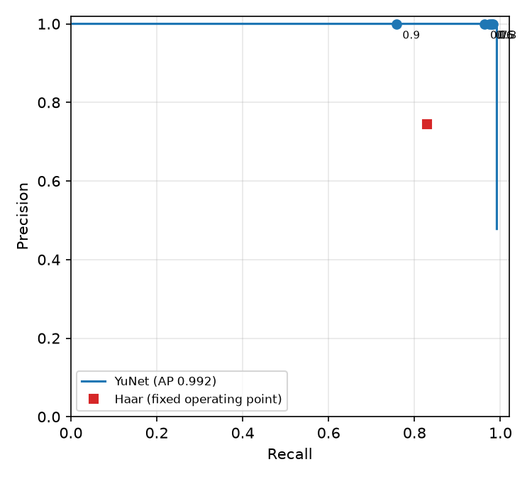
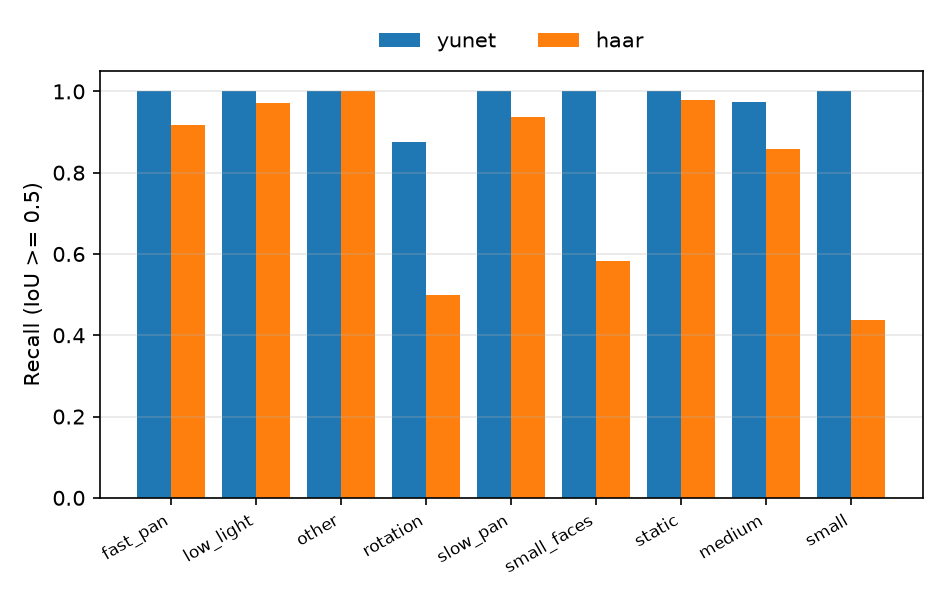
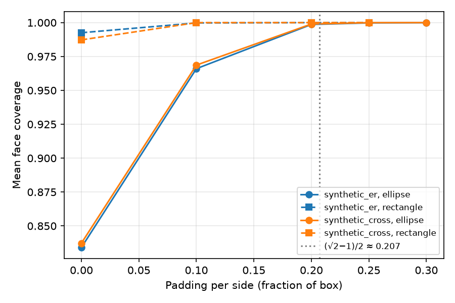

# FaceGuard — Results

Everything between the GENERATED markers is rewritten by
`python eval/run_experiments.py --config eval/experiments.yaml`. The
milestone notes after it were recorded by hand while building and are kept
as they are.

<!-- BEGIN GENERATED: eval/run_experiments.py -->

_Generated 2026-11-14 by `python eval/run_experiments.py --config eval/experiments.yaml`. Do not edit by hand; edit the script or the config and re-run._

## Environment

|  |  |
|---|---|
| CPU | Apple M5, 10 cores |
| OS | Darwin 27.2.0 |
| Python | 3.13.14 |
| OpenCV | 5.0.0 |
| Model | `face_detection_yunet_2026may.onnx` (SHA-256 `ebafce4e…22f0f0`) |
| ffmpeg | ffmpeg version 9.0.2 Copyright (c) 2000-2026 the FFmpeg developers |
| Peak RSS | 532 MB |
| Timing runs | 3 per configuration, mean ± sample std |

FPS is the processing loop (decode + detect/track + redact + write), excluding the final ffmpeg re-encode.

## Datasets

| Clip | Ground truth | Frames | Face-frames | Segments |
|---|---|---|---|---|
| synthetic_er | synthetic, exact boxes | 600 | 3600 | static, slow_pan, rotation, fast_pan, low_light, small_faces |
| synthetic_cross | synthetic, exact boxes | 450 | 1039 | approach, crossing, separate, entry, static |

Images: **0** hand-annotated, **40** stills sampled from the synthetic clip (240 faces in total).

> **No hand-annotated real images or clips yet.** Every number below comes from synthetic data built from one public group photo. Annotate real media with `eval/annotate.py` (EVALUATION.md section 1) and re-run before quoting these numbers as the tool's accuracy.

## Headline

- **synthetic_er:** detecting every 10 frames with Lucas-Kanade tracking ran at **1.54x** the throughput of per-frame detection (119.6 vs 77.5 FPS) while changing leak frames from **43** to **0**.
- **synthetic_cross:** detecting every 10 frames with Lucas-Kanade tracking ran at **2.08x** the throughput of per-frame detection (171.8 vs 82.6 FPS) while changing leak frames from **0** to **8**.

## E1 — YuNet vs Haar on images

| Detector | Images | Faces | TP | FP | FN | Precision | Recall | F1 | Mean coverage | ms / image |
|---|---|---|---|---|---|---|---|---|---|---|
| yunet | 40 | 240 | 234 | 0 | 6 | 1.000 | 0.975 | 0.987 | 0.975 | 9.730 |
| haar | 40 | 240 | 199 | 68 | 41 | 0.745 | 0.829 | 0.785 | 0.829 | 24.4 |

Per-frame detection on the clips (no tracking):

| Clip | Detector | FPS | Precision | Recall | Leak frames | Track IDs |
|---|---|---|---|---|---|---|
| synthetic_er | yunet | 77.5 | 1.000 | 0.969 | 43 | 174 |
| synthetic_er | haar | 34.4 | 0.757 | 0.825 | 230 | 313 |
| synthetic_cross | yunet | 82.6 | 0.993 | 0.999 | 0 | 4 |
| synthetic_cross | haar | 38.8 | 0.792 | 0.925 | 24 | 148 |

## E2 — detection interval sweep (LK tracking)

**synthetic_er**

| Detection | Detector calls | FPS | Leak frames | Mean coverage | Track IDs |
|---|---|---|---|---|---|
| per-frame, no tracking | 600 | 77.5 ± 1.0 | 43 | 0.970 | 174 |
| every 1 | 600 | 57.4 ± 0.2 | 0 | 1.000 | 6 |
| every 5 | 132 | 106.2 ± 1.2 | 0 | 1.000 | 6 |
| every 10 | 72 | 119.6 ± 1.4 | 0 | 1.000 | 6 |
| every 15 | 51 | 125.2 ± 0.8 | 0 | 1.000 | 6 |
| every 30 | 32 | 129.1 ± 2.1 | 0 | 0.999 | 6 |

**synthetic_cross**

| Detection | Detector calls | FPS | Leak frames | Mean coverage | Track IDs |
|---|---|---|---|---|---|
| per-frame, no tracking | 450 | 82.6 ± 0.7 | 0 | 1.000 | 4 |
| every 1 | 450 | 67.4 ± 1.3 | 0 | 1.000 | 4 |
| every 5 | 105 | 142.7 ± 1.3 | 3 | 0.997 | 4 |
| every 10 | 61 | 171.8 ± 1.3 | 8 | 0.992 | 4 |
| every 15 | 43 | 180.1 ± 4.2 | 8 | 0.992 | 4 |
| every 30 | 25 | 196.6 ± 3.3 | 8 | 0.992 | 4 |

## E3 — tracker comparison (detect every 10 frames)

**synthetic_er**

| Tracker | FPS | Leak frames | Mean coverage | ID consistency | ID switches | Track IDs | Mean frames / track |
|---|---|---|---|---|---|---|---|
| lk | 119.6 ± 1.4 | 0 | 1.000 | 1.000 | 0 | 6 | 600 |
| csrt | 20.9 ± 0.0 | 3 | 0.999 | 1.000 | 1 | 7 | 516.6 |
| kcf | 54.5 ± 0.4 | 10 | 0.996 | 0.998 | 168 | 116 | 52.0 |
| none | 174.6 ± 2.8 | 106 | 0.932 | 0.987 | 253 | 199 | 32.4 |
| off | 77.5 ± 1.0 | 43 | 0.970 | 1.000 | 168 | 174 | 20.1 |

**synthetic_cross**

| Tracker | FPS | Leak frames | Mean coverage | ID consistency | ID switches | Track IDs | Mean frames / track |
|---|---|---|---|---|---|---|---|
| lk | 171.8 ± 1.3 | 8 | 0.992 | 1.000 | 1 | 4 | 273 |
| csrt | 45.7 ± 0.4 | 8 | 0.992 | 1.000 | 1 | 4 | 273 |
| kcf | 117.0 ± 0.6 | 13 | 0.987 | 1.000 | 1 | 4 | 262 |
| none | 278.1 ± 8.7 | 62 | 0.971 | 1.000 | 4 | 7 | 151.3 |
| off | 82.6 ± 0.7 | 0 | 1.000 | 1.000 | 1 | 4 | 261.2 |

`off` = detect every frame with no memory; `none` = hold each box still between detections. ID switches count every time a ground-truth person's matched track ID changes, including re-acquisition after full occlusion.

## E4 — YuNet confidence threshold

Average precision over the image set: **0.992**.

| Threshold | Precision | Recall | F1 | FP | FN |
|---|---|---|---|---|---|
| 0.300 | 1.000 | 0.983 | 0.992 | 0 | 4 |
| 0.500 | 1.000 | 0.979 | 0.990 | 0 | 5 |
| 0.600 | 1.000 | 0.975 | 0.987 | 0 | 6 |
| 0.700 | 1.000 | 0.963 | 0.981 | 0 | 9 |
| 0.900 | 1.000 | 0.758 | 0.863 | 0 | 58 |

## E5 — condition breakdown

Images, recall at IoU 0.5 and mean mask coverage at the default padding. Size groups by box width: small < 40 px, large > 100 px.

| Group | Faces | yunet recall | yunet coverage | haar recall | haar coverage |
|---|---|---|---|---|---|
| fast_pan | 24 | 1.000 | 1.000 | 0.917 | 0.917 |
| low_light | 36 | 1.000 | 1.000 | 0.972 | 0.972 |
| other | 12 | 1.000 | 1.000 | 1.000 | 1.000 |
| rotation | 48 | 0.875 | 0.874 | 0.500 | 0.500 |
| slow_pan | 48 | 1.000 | 1.000 | 0.938 | 0.938 |
| small_faces | 24 | 1.000 | 1.000 | 0.583 | 0.583 |
| static | 48 | 1.000 | 1.000 | 0.979 | 0.979 |
| medium (size) | 224 | 0.973 | 0.973 | 0.857 | 0.857 |
| small (size) | 16 | 1.000 | 1.000 | 0.438 | 0.437 |
| synthetic (source) | 240 | 0.975 | 0.975 | 0.829 | 0.829 |

Video leak frames by segment:

**synthetic_er**

| Tracker | static | slow_pan | rotation | fast_pan | low_light | small_faces |
|---|---|---|---|---|---|---|
| lk | 0 | 0 | 0 | 0 | 0 | 0 |
| csrt | 0 | 0 | 0 | 3 | 0 | 0 |
| kcf | 0 | 0 | 9 | 1 | 0 | 0 |
| none | 0 | 28 | 48 | 19 | 0 | 11 |
| off | 0 | 0 | 43 | 0 | 0 | 0 |

**synthetic_cross**

| Tracker | approach | crossing | separate | entry | static |
|---|---|---|---|---|---|
| lk | 0 | 0 | 0 | 8 | 0 |
| csrt | 0 | 0 | 0 | 8 | 0 |
| kcf | 0 | 5 | 0 | 8 | 0 |
| none | 21 | 7 | 4 | 26 | 4 |
| off | 0 | 0 | 0 | 0 | 0 |

## E6 — padding sweep (LK, detect every 10)

Mask area ratio = masked pixels / detector box area (what padding costs).

**synthetic_er**

| Padding | Mean coverage | Leak frames | Mask area ratio |
|---|---|---|---|
| 0.000 | 0.834 | 600 | 0.891 |
| 0.100 | 0.966 | 32 | 1.263 |
| 0.200 | 0.999 | 0 | 1.703 |
| 0.250 | 1.000 | 0 | 1.931 |
| 0.300 | 1.000 | 0 | 2.190 |

**synthetic_cross**

| Padding | Mean coverage | Leak frames | Mask area ratio |
|---|---|---|---|
| 0.000 | 0.831 | 427 | 0.863 |
| 0.100 | 0.961 | 10 | 1.231 |
| 0.200 | 0.991 | 8 | 1.660 |
| 0.250 | 0.992 | 8 | 1.889 |
| 0.300 | 0.992 | 8 | 2.140 |

## E7 — early-detection policy (LK, detect every 10)

Each row adds one rule for running the detector off schedule (DECISIONS D-017). The default is the last row with the configured interval (`unconfirmed_interval` = 3).

**synthetic_er**

| Policy | FPS | Detector calls | Early | Leak frames | static | slow_pan | rotation | fast_pan | low_light | small_faces |
|---|---|---|---|---|---|---|---|---|---|---|
| scheduled only | 123.2 ± 0.6 | 60 | 0 | 0 | 0 | 0 | 0 | 0 | 0 | 0 |
| + lost track | 122.7 ± 0.8 | 60 | 0 | 0 | 0 | 0 | 0 | 0 | 0 | 0 |
| + unconfirmed, every 1 | 114.8 ± 0.5 | 94 | 34 | 0 | 0 | 0 | 0 | 0 | 0 | 0 |
| + unconfirmed, every 3 | 119.6 ± 1.4 | 72 | 12 | 0 | 0 | 0 | 0 | 0 | 0 | 0 |

**synthetic_cross**

| Policy | FPS | Detector calls | Early | Leak frames | approach | crossing | separate | entry | static |
|---|---|---|---|---|---|---|---|---|---|
| scheduled only | 182.8 ± 1.0 | 45 | 0 | 13 | 0 | 5 | 0 | 8 | 0 |
| + lost track | 181.9 ± 2.9 | 45 | 0 | 13 | 0 | 5 | 0 | 8 | 0 |
| + unconfirmed, every 1 | 153.6 ± 0.7 | 91 | 46 | 8 | 0 | 0 | 0 | 8 | 0 |
| + unconfirmed, every 3 | 171.8 ± 1.3 | 61 | 16 | 8 | 0 | 0 | 0 | 8 | 0 |

<!-- END GENERATED -->

# Milestone notes (hand-recorded)

## Environment for the milestone notes

| | |
|---|---|
| CPU | Apple M5, 10 cores (single process, OpenCV default threading) |
| RAM | 16 GB |
| OS | macOS 27.0.1 |
| Python | 3.13.14 |
| OpenCV | 5.0.0 (`opencv-contrib-python`) |
| Model | `face_detection_yunet_2026may.onnx` (SHA-256 `ebafce4e…22f0f0`) |

The M5 is faster than the "mid-range laptop" in NFR-1/NFR-2. Absolute FPS
will be lower on the demo machine; ratios between configurations are what
the report should lean on. Re-run on the demo laptop before quoting numbers.

## M2 — per-frame detection baseline

Clip: `data/samples/synthetic_er.mp4` (1280x720, 30 fps, 600 frames, 6 faces;
generated by `scripts/make_synthetic_clip.py`). Mode `pixelate`, no tracking.
FPS is the processing loop (decode + detect + redact + encode), mean ± sample
standard deviation over 3 runs.

| Detector | FPS (3 runs) | Mean | Std |
|---|---|---|---|
| YuNet | 81.3, 79.8, 76.5 | **79.2** | 2.5 |
| Haar | 29.4, 34.8, 35.3 | **33.2** | 3.3 |

Observations:

- A 20 s 720p clip processes in under 8 s with YuNet, far inside NFR-2.
- Haar is **2.4x slower** than YuNet on this CPU, not faster. The cascade's
  multi-scale sliding window over a full 720p frame costs more than one pass
  of a 224 KB CNN on an Apple-silicon CPU. This contradicts the common
  assumption that classical detectors are the "fast" option.
- Because YuNet is already fast, the main argument for tracking in M3 is
  covering detector misses (leak frames), not throughput.

## M3 — detect every 10 frames and track in between

Same clip, machine and FPS definition as M2 (`process_video`, mode
`pixelate`, YuNet, 3 runs). Leak frames are frames containing at least one
ground-truth face with mask coverage < 0.90 (`eval/metrics.py`), counted
against the synthetic clip's exact per-frame ground truth (600 frames, all
with faces). Coverage is per face-frame.

| Config | FPS (3 runs) | Mean ± std | Detector calls | Leak frames | Mean coverage | Tracks (6 faces) |
|---|---|---|---|---|---|---|
| per-frame (`--tracker off`) | 76.9, 76.5, 76.8 | 76.7 ± 0.2 | 600 | **43** | 0.970 | 174 |
| interval 10, hold box (`none`) | 257.6, 240.1, 257.1 | 251.6 ± 9.9 | 60 | 232 | 0.809 | 155 |
| interval 10, **LK** | 118.8, 122.4, 123.2 | **121.5 ± 2.4** | 60 | **0** | 1.000 | 6 |
| interval 10, CSRT | 21.3, 21.3, 21.3 | 21.3 ± 0.0 | 60 | 3 | 0.999 | 7 |
| interval 10, KCF | 72.4, 73.7, 74.0 | 73.4 ± 0.9 | 60 | 77 | 0.940 | 49 |

Leak frames by segment:

| Config | static | slow pan | rotation | fast pan | low light | small faces |
|---|---|---|---|---|---|---|
| per-frame | 0 | 0 | 43 | 0 | 0 | 0 |
| hold box | 0 | 65 | 100 | 37 | 0 | 30 |
| LK | 0 | 0 | 0 | 0 | 0 | 0 |
| CSRT | 0 | 0 | 0 | 3 | 0 | 0 |
| KCF | 0 | 0 | 41 | 36 | 0 | 0 |

Observations:

- **Acceptance met.** LK at interval 10 runs at **1.58x** the per-frame
  baseline (121.5 vs 76.7 FPS) while leak frames fall from **43 to 0**.
- Leak frames go *down* with tracking although the detector runs 10x less
  often. All 43 per-frame leaks are in the rotation segment, where YuNet
  misses faces rolled ~40°; per-frame detection has no memory, so a missed
  frame is an exposed frame. LK keeps following those faces (D-012).
- Per-frame detection fragments identity: 174 track IDs for 6 people, because
  every miss ends a track. LK keeps exactly 6.
- Holding the box still (`none`) is the fastest and the worst: 232 leak
  frames, because the box stays behind while the face moves. Speed alone is
  not the reason to track; motion is.
- KCF has fixed scale and loses the rolled and fast-moving faces. CSRT is
  nearly as good as LK but 5.7x slower.
- The first LK implementation ran at 66.5 FPS, *slower* than the baseline:
  each track built two full-frame pyramids per frame. Restricting LK and
  corner seeding to a search window around each face fixed it (D-014).
- All numbers are on one synthetic clip; E2/E3 in Week 5 repeat them on the
  annotated real clips.
